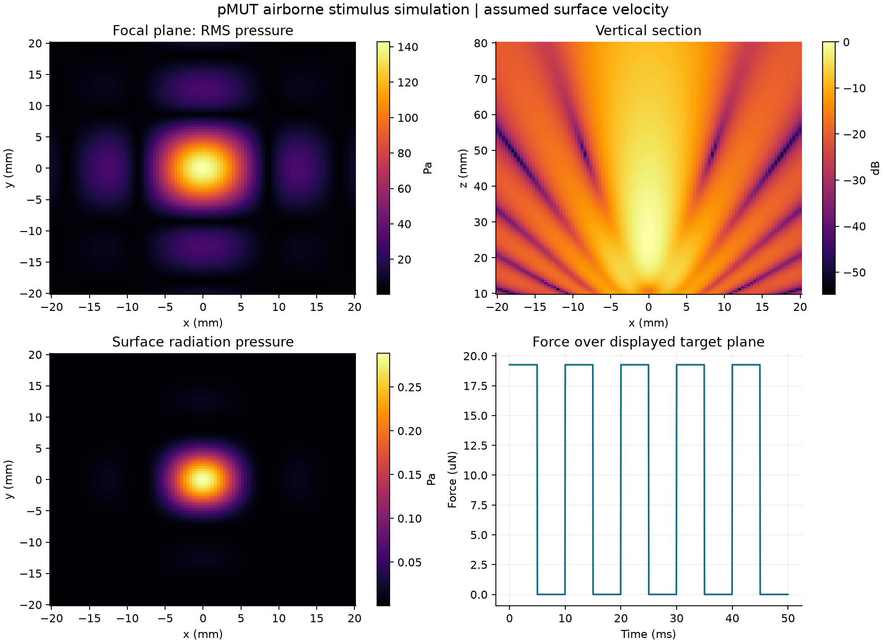

# pMUT 空中超声触觉仿真实验台

从实习报告的 Python 声场与成像脚本，整理为可安装、可配置、可测试、可复现的软件项目。主线是 **二维 pMUT 阵列 → 空气声场 → 低频调制 → 表面辐射压与合力**，提供 Python 命令行、Streamlit 界面，以及可独立打开的 HTML 实验台。HTML 使用与 Python 逐点对照的浏览器计算实现。

工程版本 **0.2.0**，2026-10-18 增加实验库、参数扫描、数值质量检查和非理想阵列鲁棒性分析。这是一套数值仿真与工程验证工具：输入振速尚未用驱动电压标定，输出不能直接作为人体可感知性或实物性能的证明。第一版不含皮肤力学。



## 打开实验台

- **[在线打开实验台](https://tenderzzz.github.io/pmut-haptics/)**：直接在浏览器运行。
- **[下载离线 HTML](https://github.com/tenderzzz/pmut-haptics/releases/latest/download/pmut-haptics.html)**：保存后用浏览器打开。
- **[下载完整项目与安装包](https://github.com/tenderzzz/pmut-haptics/releases/latest)**：在 Release 的 Assets 中选择项目 ZIP、wheel 或源码包。

GitHub 仓库中的 HTML 文件页面用于查看源码，不会运行实验台；文件约 4.9 MB，源码预览也可能因大小限制无法显示。请使用上述在线或下载入口。

离线使用时，双击本地项目根目录的 **pmut-haptics.html** 即可。 只需这一个文件，可复制或转发，不用安装 Python、不用启动本地服务。包含参数调整、声场、三维阵列几何与目标轨迹、调制、轨迹回放、实验对比和数据导出。三维图支持旋转、缩放、俯视、侧视和图片保存；绘图库已内嵌，文件约 4.9 MB，仍无外部运行依赖。

使用方法、功能范围和开发说明见 [HTML 指南](docs/html.md)；数值与浏览器检查见 [HTML 验证记录](docs/html-verification.md)。

## 0.2.0 实验工作流

0.2.0 提供在线实验台与可下载的离线 HTML；两者使用同一份构建内容。

- **实验库**：保存、备注、快照、备份恢复、最多四组比较与可打印报告。
- **参数扫描**：自定义单参数范围，区分固定真实间距与波长间距，保留失败原因与部分结果。
- **质量检查**：网格加密、区域扩大、截断及焦点误差；可导入 Python 独立积分报告。
- **鲁棒性**：幅度/位置/相位误差、失效阵元和量化，保存实际样本，对比统计分布与理想基准。

完整流程和复现命令见 [实验工作流指南](docs/laboratory.md)，实际结果见 [0.2.0 验证记录](docs/verification-v02.md)。

## 运行完整 Python 工程

历史水中成像、旧版随机相位复现、独立积分检查、大批量任务和性能分析使用完整工程。需要 Python 3.12 和 uv。已有环境可运行：

```sh
sh scripts/setup.sh
.venv/bin/pmut-haptics demo
```

打开 <http://127.0.0.1:8501>。选择静态触点、往复直线或圆形轨迹，调整参数后点击“运行仿真”，可查看声场、调制合力、运动回放和实验对比，并下载配置与数据。

生成一组可保存的实验：

```sh
.venv/bin/pmut-haptics run --config configs/midair_touchpoint.toml --output outputs/my-touchpoint
```

输出目录必须是新目录，防止覆盖已有实验。完整环境、Windows 命令以及 iCloud 目录注意事项见 [复现指南](docs/reproduce.md)。

## 已实现的能力

| 部分 | 内容 |
| --- | --- |
| 模型 | 均匀介质圆活塞、二维相控阵、可选 Hann 加权、衰减、固定随机种子的相位误差 |
| 刺激 | 峰值/RMS 声压、SPL、声强、辐射压、有限平面合力、主瓣宽度与旁瓣 |
| 驱动 | 连续波、脉冲、正弦幅度调制；静态、往复直线和圆形焦点轨迹 |
| 工程 | TOML 参数、输入校验、分块计算、共享 API、CLI、交互界面、结果校验和 |
| 验证 | 解析解、独立积分、对称性、相位聚焦、原报告回归、调制频谱、DAS 与界面测试 |
| 历史成果 | 保留 598 行附录代码，提供原始水中仿真与修正版对照，不覆盖实习材料 |

默认空气示例使用 12×12 阵列、109.4 kHz、415 μm 阵元半径；这些参数参考 Pala 等人的[非接触 pMUT 研究摘要](https://bsac.berkeley.edu/node/328)。0.5λ 间距、50 mm 焦距和 1 m/s 峰值振速是本项目示例假设。三篇本地文献的用途及与主线的区别见 [来源审计](docs/source_audit.md)。

## 可核查的结果

- 默认场景的声压 −6 dB 宽度约 **10.26 mm**，辐射压半高宽约 **7.53 mm**；这些是给定模型与输入下的计算值。
- 同模型、同精度的逐点参考实现与分块实现完成三档性能比较。实测记录、重复样本和误差见 [性能报告](docs/performance.md)。
- 原报告的五点成像宽度表可复现；第 13 页参数扫描表与附录代码输出不一致，已保留差异，未将其作为新项目成果。
- 修复了历史聚焦相位、离轴积分、回波记录窗口、包络成像和宽度定义问题。修正版仍受原水中低频模型分辨率限制。

完整图表与解释见 [实验结果](docs/results.md)。测试数量与最后一次验证记录见 [交付验证记录](docs/verification.md)。

## 项目结构

```text
pmut-haptics.html    可直接打开和转发的独立实验台
web/                HTML、样式、浏览器计算核与交互源码
src/pmut_haptics/    配置、声场、刺激、成像、实验、导出、界面
configs/            5 个可直接运行的预设
tests/              物理性质、数值回归、流程与界面测试
scripts/            环境检查、完整复现、模型验证、HTML 构建与预览
docs/               模型、参数、来源审计、性能、复现、面试说明
docs/results/       本次核验的精简数据和图表快照
outputs/            本地完整运行记录与原始数组，不进入源码包
```


## 常用入口

```sh
.venv/bin/pmut-haptics config --output my-config.toml
.venv/bin/pmut-haptics sweep --output outputs/my-sweep
.venv/bin/pmut-haptics benchmark --output outputs/my-benchmark
.venv/bin/pmut-haptics reproduce --profile original --output outputs/my-original
.venv/bin/pmut-haptics reproduce --profile corrected --output outputs/my-corrected
.venv/bin/python -m pytest
.venv/bin/python scripts/reproduce_all.py --output outputs/my-full-run
```

Python 调用：

```python
from pmut_haptics.config import load_config
from pmut_haptics.simulation import simulate
from pmut_haptics.export import save_result

result = simulate(load_config("configs/midair_touchpoint.toml"))
print(result.metrics["pressure_x_minus6db"])
save_result(result, "outputs/python-example")
```

继续阅读：[物理模型](docs/model.md) · [参数字典](docs/configuration.md) · [复现指南](docs/reproduce.md) · [面试演示与项目表述](docs/interview.md)。

项目仓库：[tenderzzz/pmut-haptics](https://github.com/tenderzzz/pmut-haptics)。

原实习工作与本次 AI 辅助工程化增量分别记录。项目尚未指定开源许可证；第三方 Plotly 许可随代码保留，第三方论文全文与私人实习报告不随仓库分发。
