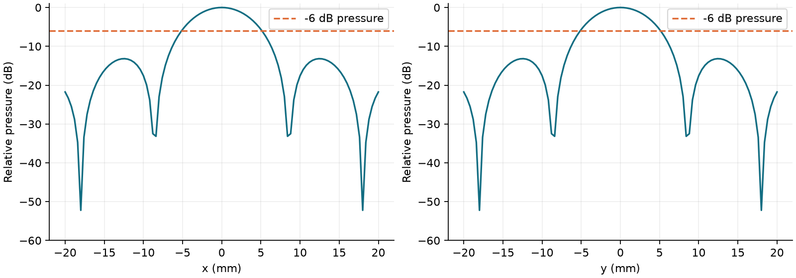
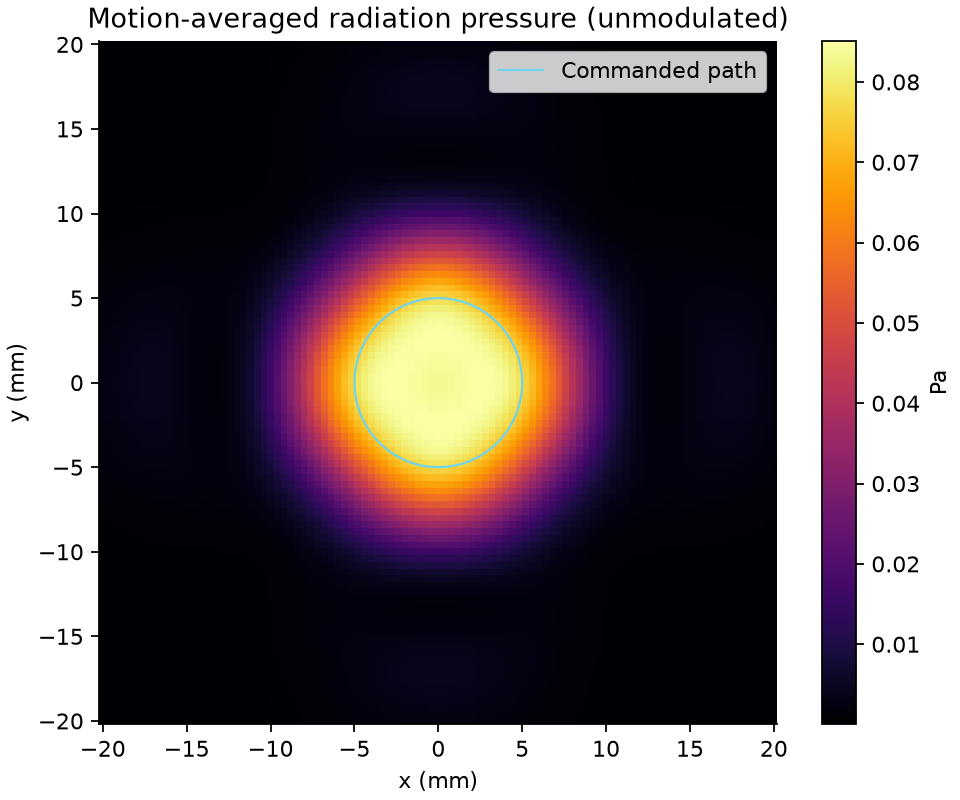
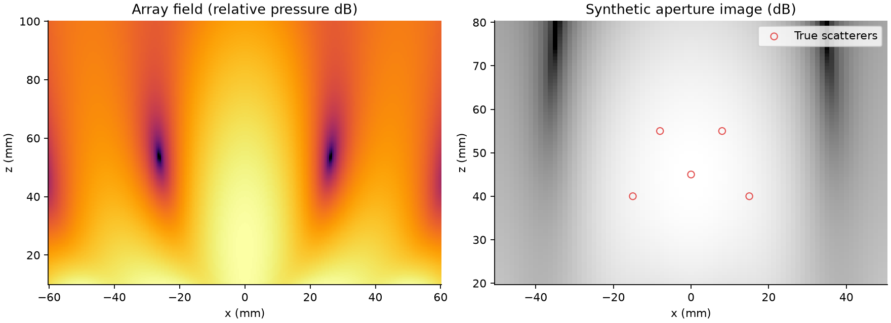

# 本次实验结果

日期：2026-10-14。精简快照存放在 results/，每个文件由 [manifest.json](results/manifest.json) 校验。完整数组与日志在本地 outputs/verified-20261014/，不随源码包分发。

## 默认空气静态触点

输入：12×12 阵列、109.4 kHz、半径 415 μm、间距 0.5λ、焦点 (0,0,50) mm、空气 ρ=1.2 kg/m³/c=343 m/s、振速峰值 1 m/s、κ=2、未加入衰减或相位误差。

| 指标 | 结果 |
| --- | ---: |
| 目标平面峰值声压 | 201.834 Pa |
| 目标平面最大 RMS 声压 | 142.718 Pa |
| SPL，re 20 μPa | 137.069 dB |
| 近似最大声强 | 49.486 W/m² |
| 最大载波平均辐射压 | 0.288547 Pa |
| x/y 声压 −6 dB 宽度 | 10.263 mm |
| x/y 辐射压 FWHM | 7.532 mm |
| 视野内 x/y 旁瓣水平 | −13.182 dB |
| ±20 mm 目标平面内合力 | 19.260 μN |
| 100 Hz、50% 脉冲后的平均合力 | 9.630 μN |

以上均为**给定振速假设下的仿真值**，不是测得的器件输出、驱动电压性能或人体触觉阈值。数值来自 [metrics](results/touchpoint_metrics.json) 与 [完整配置](results/touchpoint_config.toml)。

## 运动路径与空间分辨率

圆轨迹半径 5 mm，而默认辐射压 FWHM 约 7.5 mm，邻近触点会明显重叠。时间平均图趋于填满中心区域，不能把圆形指令路径直接描述为清晰可触的空心圆。该示例用来解释轨迹指令、瞬时场与时间平均刺激之间的差别。

高采样率刺激波形应用 m²；动画帧展示未调制、载波平均的场分布。正弦调制的平均平方包络为 0.375，50% 脉冲为 0.5，频谱性质有自动测试覆盖。

## 阵列规模与间距扫描

下面选取 d=0.5λ，保持 Σ|u|²=144 (m/s)² 的结果。该归一化是振速预算代理，不是电功率约束。扫描使用 81×81 目标网格，因此与默认 101×101 结果有小幅采样差别。

| 阵列 | 每阵元振速 m/s | 最大辐射压 Pa | 声压 −6 dB 宽度 mm | 平面内合力 μN |
| --- | ---: | ---: | ---: | ---: |
| 8×8 | 1.50 | 0.13017 | 15.317 | 18.433 |
| 12×12 | 1.00 | 0.28855 | 10.263 | 19.260 |
| 16×16 | 0.75 | 0.50265 | 7.788 | 20.081 |

在这组固定焦距条件下，更大有效孔径使主瓣更窄，峰值集中度提高。不能只依据峰值选择“最佳”间距：增大间距还会改变视野外辐射、偏转时的栅瓣与阵列尺寸。本扫描不构成全扫描角范围的最优设计证明。

两种归一化的完整九组结果分别见 [固定振速平方和](results/scan_fixed.json) 和 [固定每阵元振速](results/scan_per_element.json)。后者随阵元数增加而增加总振速平方和，不能与前者混用。

## 数值正确性

| 检查 | 相对 L2 误差 |
| --- | ---: |
| 圆盘轴向积分对解析解 | 1.16×10⁻¹⁵ |
| 空气三点积分由 12×24 升至 40×96 阶 | 8.09×10⁻¹⁶ |
| 快速圆活塞近似对完整积分，三个指定空气点 | 3.70×10⁻³ |
| 随机点同模型逐点与分块后端 | 3.53×10⁻¹⁶ |

第三项约 0.37% 是模型近似误差，其余是不同计算方法的一致性误差。不要混成一个“精度达到 10⁻¹⁵”的物理准确度声明。验证坐标、参数、容差与环境见 [validation.json](results/validation.json)。

## 水中历史结果与修正版

原五点成像宽度回归通过，但原代码存在相位、积分、记录窗口和度量问题。修正版孤立 PSF 的横向宽度约 23.43–25.33 mm；轴向宽度均被 ROI 截断，保存为 null，而非捏造有限数值。五点合成图仍为宽峰，不支持“清晰分辨五点”的结论。

原始与修正指标见 [original_metrics.json](results/original_metrics.json)、[corrected_metrics.json](results/corrected_metrics.json)。表 5 不一致与修改依据见 [来源审计](source_audit.md)。性能提升则见 [相同模型的独立基准](performance.md)。
